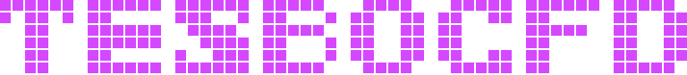
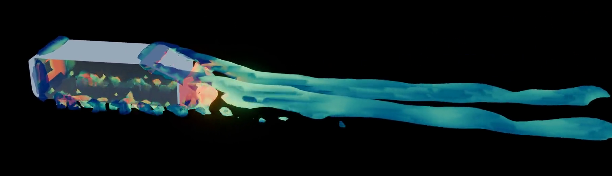
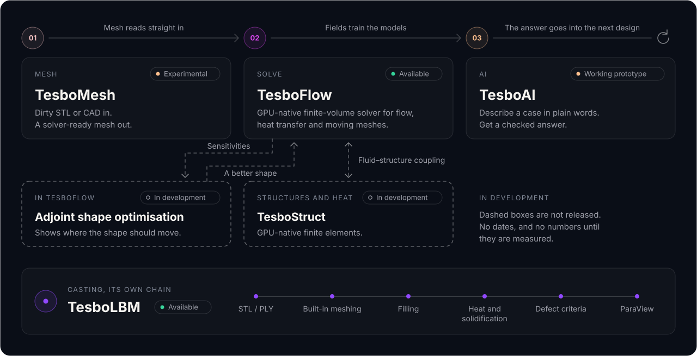
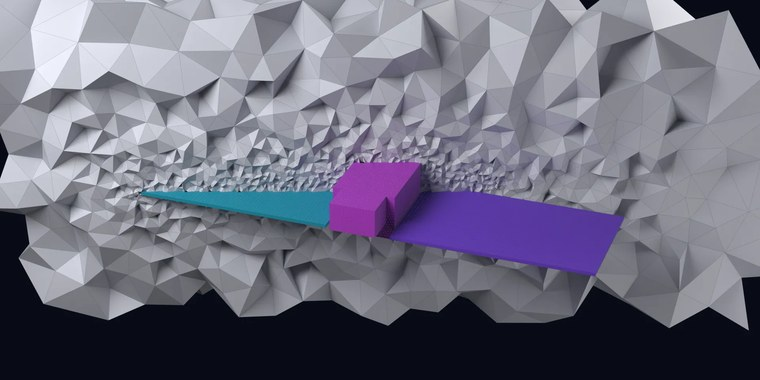
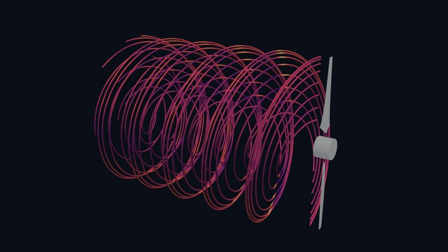
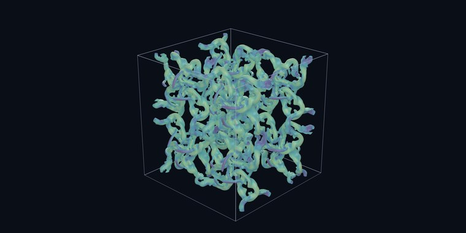
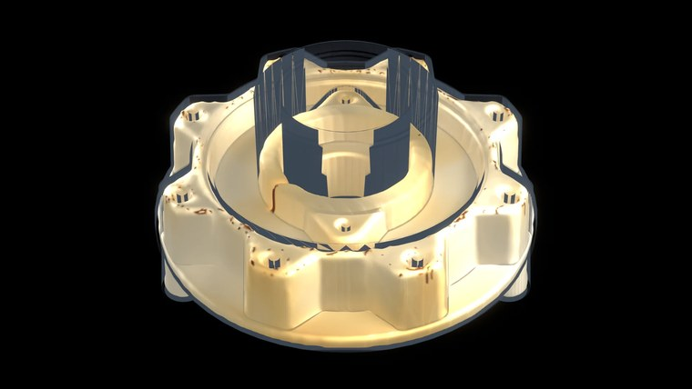

### Days of CFD. Done before lunch.

[][site]
[][case]

TesboCFD is commercial, GPU-native simulation software for engineering teams
whose CFD runs take days. This page is the product overview. It holds no source
code. To see it on your own problem, **[send us your case][case]**.

## Four products. One CFD loop.

TesboMesh meshes, TesboFlow solves, TesboAI learns from the results, and the
answer goes into the next design. Casting has its own chain in TesboLBM. Each
product carries the status it has on [tesbocfd.com][site].

The dashed boxes are in development: adjoint shape optimisation inside
TesboFlow, TesboStruct for structures and heat, and fluid–structure coupling
between the two solvers. They are not released. They carry no dates here, and
no numbers until they are measured.

## The products

### TesboMesh

*Experimental* · [tesbocfd.com/tesbomesh][mesh]

**Dirty STL in. Solver-ready mesh out.** It takes STL, however dirty, or CAD.
It wraps, layers and quality-gates, and TesboFlow reads the mesh directly. The
quality gate is the exit code.

Measured: 1M dirty triangles wrapped in 56 s on 8 threads. The volume matches
the analytic union to six decimals. 51% hex by volume.

Picture: Europa Clipper, the clean geometry. 307,745 cells. Quality gate green.

 

### TesboFlow

*Available* · [tesbocfd.com/tesboflow][flow]

GPU-native finite-volume CFD: incompressible and compressible flow, conjugate
heat transfer, dynamic and overset mesh. Ansys Fluent and OpenFOAM meshes and
cases import, and results open in ParaView.

Measured. Typical scenes, not a contract:

- **3,000×** one CPU core. 1M-cell cavity: 77 s a step on one CPU core, 22.8 ms on one H200.
- **100×** eighteen CPU cores. 8.17M-cell Ahmed body: 11.4 s a step on 18 Xeon cores, 94 ms on one H200.
- **110.6 million cells** on 8×A100 at 1.5 s a step.

Picture: NREL Phase VI rotor. Flow structure, not a performance result.

 

### TesboAI

*Working prototype* · [tesbocfd.com/tesboai][ai]

**Talk to the solver. Trust the answer.** Describe the case in plain words.
TesboAI builds it, runs it on TesboFlow and checks every number before you see
it. The model never invents a value. Underneath, neural surrogates are trained
on TesboFlow fields and tested offline on benchmark cases. It runs on a local
model, so your data stays on-site.

Picture: vortex cores of a 3-D Taylor-Green vortex. A reference CFD field, not a model prediction.

 

### TesboLBM

*Available* · [tesbocfd.com/tesbolbm][lbm]

A GPU-native lattice Boltzmann solver built around free surfaces. For casting,
filling, heat transfer and solidification run as one pipeline, with defect
criteria in the results. STL or PLY in, built-in meshing, ParaView out.

Measured on one Tesla V100, single-phase kernel peak:

- **55×** all 18 CPU cores of the same machine under MPI: 1851 MLUPS against 33.9. This is the figure we quote.
- **451×** one core of that machine, at 4.1 MLUPS.

A coupled free-surface fill on a real casting runs at roughly 450 MLUPS
effective, because it carries more fields and more passes per step.

Picture: an aluminium pump body in gravity sand casting, part-way through filling.

 

### In development

Not released. No dates, and no numbers until they are measured.

- **Adjoint shape optimisation**, inside TesboFlow. The solver works out where the surface should move, deforms the mesh and solves again.
- **TesboStruct.** A GPU-native finite element solver for structural mechanics and heat transfer.
- **Fluid–structure coupling.** TesboFlow and TesboStruct exchange loads and motion, in both directions.

## How an evaluation goes

1. **Send us a case you have already run.** Tell us the mesh size, the physics, what you ran and on what hardware. Please do not attach the mesh in the first message.
2. **We run it in TesboFlow.** Any physics we sell. The solver stays with us.
3. **We send back accuracy, wall-clock time and memory.**

**[Send us your case][case]**. Licences are annual and node-locked. There is no
online store and no perpetual licence: [request a quote][quote].

## Contact

| | |
|:---|:---|
| **Email** | support@tesbocfd.com |
| **Web** | [tesbocfd.com][site] · [Send us your case][case] |
| **GitHub** | [github.com/Tes-bo](https://github.com/Tes-bo) |
| **Training** | [Tutorials][training] |

Partnerships and investment: [say hello][invest].

---

© TesboCFD. All rights reserved. This repository is a product overview and holds no source code. TesboCFD software is commercially licensed.

[site]: https://www.tesbocfd.com/?utm_source=github
[case]: https://www.tesbocfd.com/contact?intent=evaluation&utm_source=github
[quote]: https://www.tesbocfd.com/contact?intent=quote&utm_source=github
[invest]: https://www.tesbocfd.com/contact?intent=investment&utm_source=github
[training]: https://www.tesbocfd.com/tutorials?utm_source=github
[flow]: https://www.tesbocfd.com/tesboflow?utm_source=github
[mesh]: https://www.tesbocfd.com/tesbomesh?utm_source=github
[lbm]: https://www.tesbocfd.com/tesbolbm?utm_source=github
[ai]: https://www.tesbocfd.com/tesboai?utm_source=github
